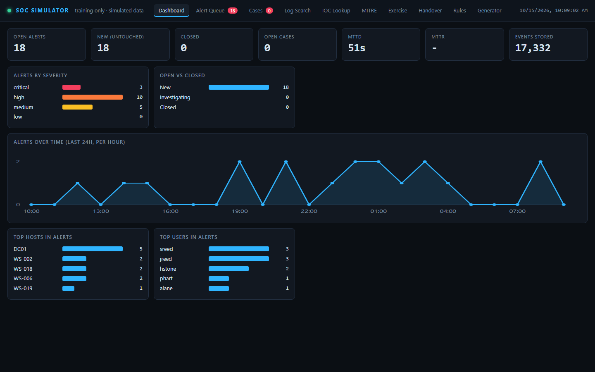
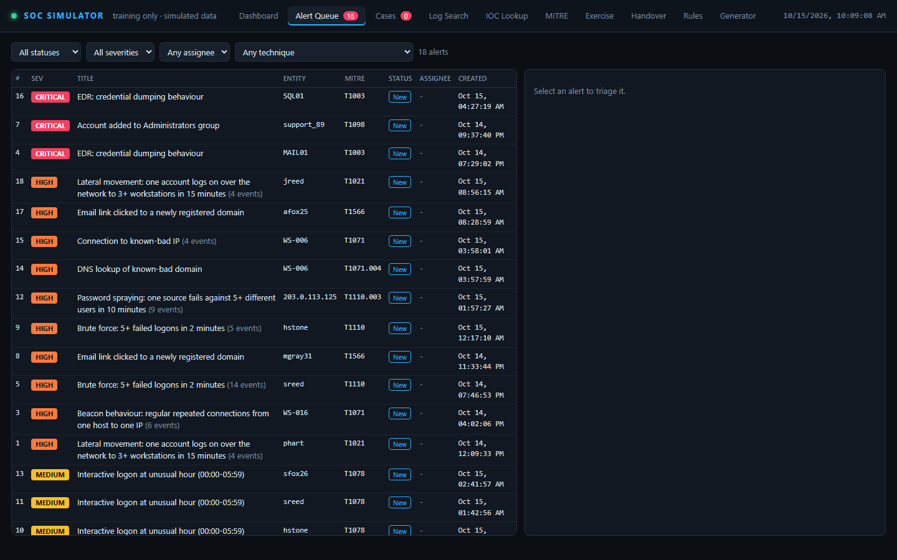
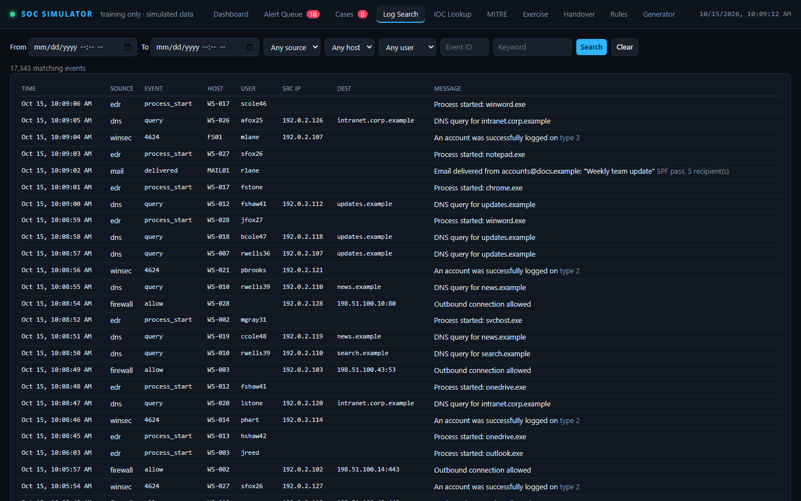
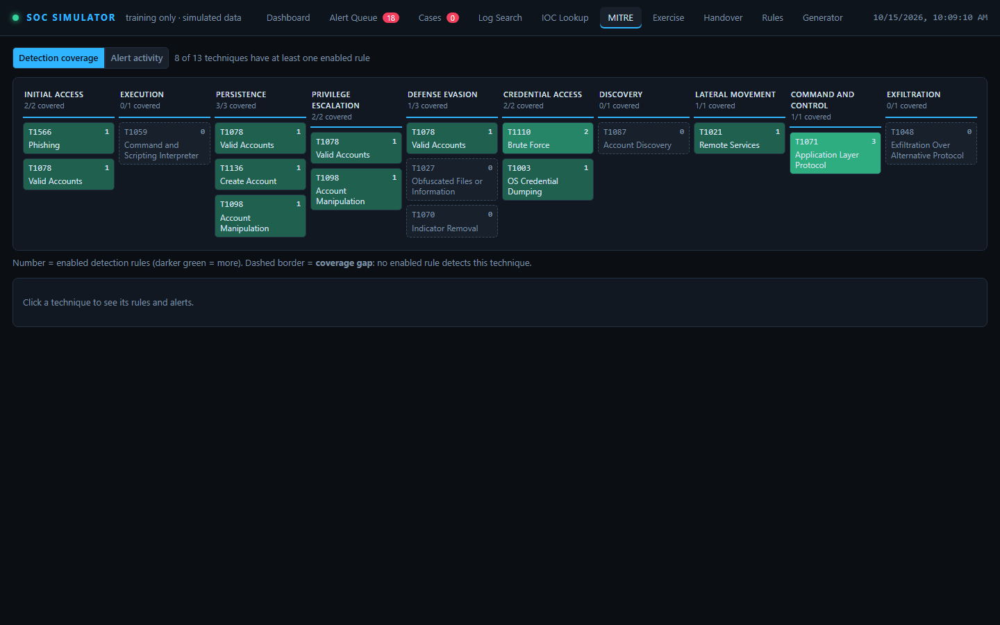
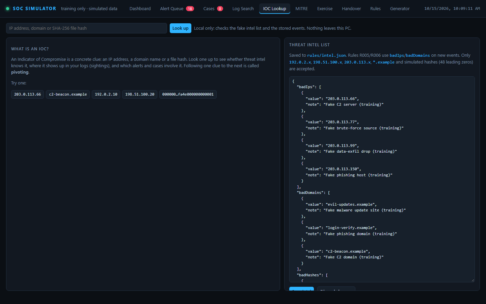
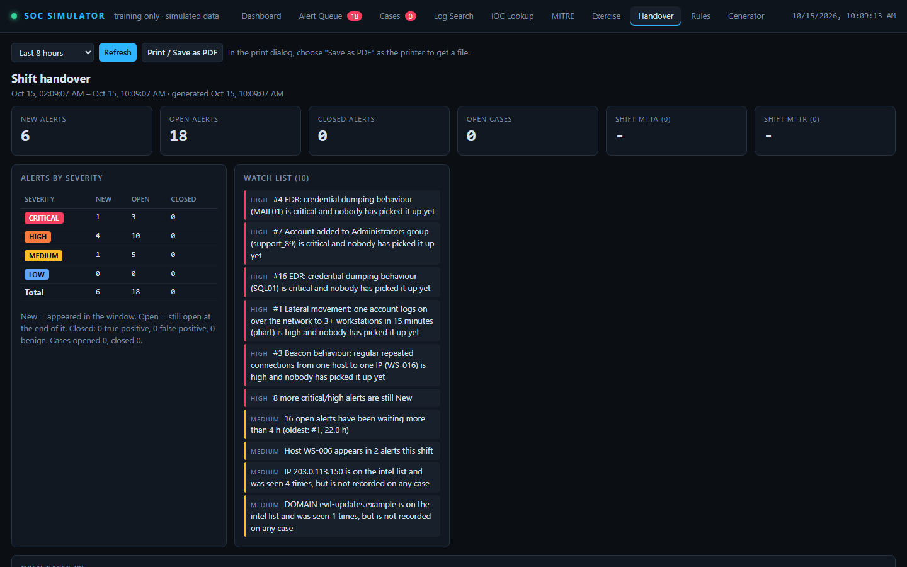

# SOC Range

A practice Security Operations Center that runs entirely on your PC at **http://127.0.0.1:5000**.
It generates a live stream of security logs for a fictional company, detects attacks in that stream with a small
SIEM rule engine, and gives you an analyst console to triage alerts, run incident cases and practise scored exercises.

I built it to learn and demonstrate the day-to-day work of a SOC analyst (detection, triage, incident response,
threat-intel pivoting and shift handover) without needing a real network, real logs or commercial tooling.

> **Simulated data only.** Every log, user, host, IP address, domain, file hash and "attack" is made up by the
> built-in generator. IPs come only from the documentation ranges `192.0.2.0/24`, `198.51.100.0/24` and
> `203.0.113.0/24`, and domains end in the reserved `.example` TLD. The app reads no real logs, makes no
> outbound network calls and refuses real-looking IPs, domains and hashes in its lookups. It contains no real
> malware or attack tooling.

## Overview

A self-contained Security Operations Center training range: a fake company produces a live stream of Windows,
firewall, DNS, EDR, mail and change-ticket logs. A small SIEM engine detects attacks in that stream, and an analyst
console takes each alert through triage, incident cases, threat-intel pivots, scored exercises and shift handover.
Everything is simulated and runs on one machine with a single runtime dependency (Express).

### Features

| Area | In this project |
|---|---|
| Detection engineering | 11 JSON rules across 4 rule types: single-event match, threshold (raw or distinct-value counts), intel lookup and beacon (interval regularity). Each rule is tuned against background noise, and a soak test checks the false-positive rate |
| SOC triage | Alert queue with assignee, status, verdict (TP / FP / benign), analyst-adjustable severity and alert de-duplication |
| Incident response | Cases that follow the NIST SP 800-61 lifecycle, a merged timeline, IOCs on cases and per-rule playbooks |
| Threat intelligence | IOC lookup and pivoting over local data, an editable intel list, MITRE ATT&CK coverage and activity heatmap |
| Analyst training | 15 scenarios (attacks plus benign and false-positive look-alikes), each with a computed answer key, and scoring on verdict, severity, escalation, MTTA/MTTR, playbook use and notes |
| Operations | Shift-handover report with an auto-generated watch list and print-to-PDF |
| Safe-by-design engineering | Binds to 127.0.0.1 by default (the Docker setup publishes on 127.0.0.1 only); documentation-range IPs and `*.example` domains only; validators refuse real-looking IPs, domains and hashes; no outbound calls; CSRF header on state changes |

### Detection rules

| ID | Detects | Type | MITRE |
|---|---|---|---|
| R001 | Brute force: 5+ failures for one user in 2 min | threshold | T1110 |
| R002 | New user account created | match | T1136 |
| R003 | Account added to Administrators | match | T1098 |
| R004 | Interactive logon at 00:00–05:59 | match | T1078 |
| R005 | Connection to an intel-listed IP | lookup | T1071 |
| R006 | DNS lookup of an intel-listed domain | lookup | T1071.004 |
| R007 | EDR credential-dumping behaviour | match | T1003 |
| R008 | Email link clicked to a domain under 30 days old | match | T1566 |
| R009 | Password spraying: one source, 5+ distinct users in 10 min | threshold (distinct) | T1110.003 |
| R010 | Lateral movement: one account, 3+ workstations over the network in 15 min | threshold (distinct) | T1021 |
| R011 | Beacon: 6 regular connections to the same IP in 15 min | beacon | T1071 |

### Architecture

```
generator.js --events--> store.js (in memory, saved to %LOCALAPPDATA%) --> detection.js (rules/*.json)
                                                                              |
     public/ (vanilla JS UI)  <--  server.js (Express, 127.0.0.1)  <--  alerts / cases / playbooks /
                                                                        ioc / mitre / exercise / handover
```

### Tech stack

- **Node.js 22+** and **Express 4** (the only runtime dependency)
- Plain HTML, CSS and JavaScript front end: no framework, no build step, no CDN
- JSON files for detection rules, playbooks, threat intel and scoring, editable without code changes
- **101 automated tests** with the built-in `node:test` runner (see [Tests](#tests))

### Screenshots

All screenshots show simulated data only.

| Dashboard | Alert Queue |
|---|---|
|  |  |
| **Log Search** | **MITRE ATT&CK coverage** |
|  |  |
| **IOC Lookup** | **Shift handover** |
|  |  |

## Getting started

Requires **Node.js 22 or later**.

```bash
git clone https://github.com/Khaja-syed-786/soc-range.git
cd soc-range
npm install
npm start
```

Then open **http://127.0.0.1:5000**. On first start the simulator seeds 24 hours of history so the dashboard is
not empty. On Windows you can also use the helper scripts:

```
start.cmd      (or .\start.ps1)  - installs deps on first run, starts in background, opens browser
stop.cmd       (or .\stop.ps1)   - saves state and stops
```

Settings (port, data folder, event rate) are in `config.json`; see the [user guide](docs/user-guide.md#settings-and-saved-state).

### Run with Docker

Requires Docker with Compose v2. From the cloned `soc-range` folder:

<!-- docker-quickstart: CI runs the commands in this block (see .github/workflows/docker.yml) -->
```bash
docker compose up -d --build --wait
```
<!-- /docker-quickstart -->

Then open **http://127.0.0.1:5000**. `docker compose down` stops it and keeps your data;
`docker compose down -v` also deletes the saved state and any rules, intel or playbooks you edited.

The container runs as a non-root user with a read-only filesystem, no Linux capabilities and
`no-new-privileges`. The only writable paths are two named volumes: `/data` (saved state) and
`/app/rules` (rules, intel and playbooks edited in the UI). Inside the container the app listens on
`0.0.0.0` so the published port can reach it, so its log shows a `WARNING: listening on 0.0.0.0`
line; that is expected.

> [!WARNING]
> **Keep the `127.0.0.1:` prefix when publishing the port.** `compose.yaml` publishes it as
> `127.0.0.1:5000:5000`, so only this PC can reach the app. If you run the image yourself, use
> `docker run -p 127.0.0.1:5000:5000 soc-range:local`. **`docker run -p 5000:5000`** (or `"5000:5000"` in
> compose) without the prefix publishes the app on every network interface of your machine, and on Linux
> Docker's port rules bypass host firewalls such as ufw. SOC Range has no login, so anyone on your network
> could then read and change it.

## Tests

The project has **101 automated tests** using Node's built-in test runner. They need no extra packages and no
network access.

```bash
npm test                # all tests
npm run test:coverage   # with a coverage report; fails under 90% line coverage
npm run lint            # ESLint
```

| File | Covers |
|---|---|
| `test/core.test.js` | Event generator, detection rules, alert queue and triage, cases, playbooks, state persistence and upgrades |
| `test/mitre-ioc.test.js` | MITRE ATT&CK coverage and activity heatmap, IOC lookup, editable intel list, IOCs on cases |
| `test/exercise-handover.test.js` | Scenario mode and scoring, answer keys, MTTA/MTTR, shift handover |
| `test/advanced-detections.test.js` | Phishing, password spraying, lateral movement and beacon detections, and a false-positive soak test |
| `test/engine.test.js` | The live loop: event rate, scenario drip-feed, auto-scenarios, tick hooks, start/stop |
| `test/config.test.js` | The listen address (`SOCSIM_HOST`, default 127.0.0.1) and the non-loopback startup warning |
| `test/server.test.js` | The HTTP API, started on a random local port: CSRF header check, validation, scenario injection, IOC lookup, cases, reset |

## Documentation

| Guide | What it covers |
|---|---|
| [User guide](docs/user-guide.md) | The fake company, every screen, settings and the basic practice scenarios |
| [SOC concepts in plain words](docs/soc-concepts.md) | SOC, SIEM, event IDs, triage, severity, verdicts, MITRE, IOCs, beaconing, MTTD/MTTR |
| [Incident cases and playbooks](docs/incident-cases-and-playbooks.md) | Alerts vs. cases, the NIST lifecycle, editable playbooks |
| [MITRE ATT&CK and IOC lookup](docs/mitre-and-ioc.md) | Coverage and activity heatmaps, IOC pivoting, the editable intel list |
| [Exercises and shift handover](docs/exercises-and-handover.md) | Scored scenario mode, answer keys, MTTA/MTTR, the handover report |
| [Advanced detections](docs/advanced-detections.md) | Phishing, password spraying, lateral movement and beacon behaviour |
| [Architecture](docs/architecture.md) | Data flow, project layout, saved state, development history |

## License

[MIT](LICENSE). This is a personal learning and portfolio project. All data is simulated.
