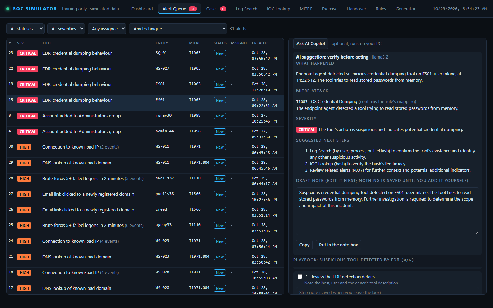

# AI Triage Copilot (optional)

[← Back to README](../README.md)

An optional helper for the analyst console. On any alert, and on any incident case, **Ask AI Copilot** gives you:

1. A plain-English summary of what happened
2. A MITRE ATT&CK mapping (tactic and technique ID), saying whether it confirms, refines or differs from the rule's mapping. The model's technique ID is checked, and its tactic is not trusted: the tactic comes from the rule when the technique is the rule's own (or shares its parent), otherwise from a built-in ATT&CK map, and only as a last resort from the model, labelled "AI-suggested". If the technique ID is not valid, the rule's own mapping is shown instead and marked "from detection rule"
3. A severity assessment with a short justification. If any indicator in the alert (IP, hash or domain) is on the simulator's intel list, the severity is at least high
4. 3-5 suggested next investigation steps, limited to what exists in the simulator: Log Search, IOC Lookup, related
   alerts, the alert's playbook and the case timeline. Steps that are empty, too short, template placeholders or duplicates are dropped
5. A draft incident note you can edit and paste into the case

Above the AI's answer you also get **Verified facts**: the server looks up every indicator in the alert in its own intel list and states what it found, for example "Verified: 203.0.113.77 is on the threat-intel list (Fake brute-force source (training))". These lines are not written by the AI. If the AI says "false positive", or says an indicator is not on the intel list, while one is, a warning tells you to trust the verified facts.

Every answer is labelled **AI suggestion: verify before acting**. It is a second opinion from a small local model,
not an answer key. Small models get things wrong, so check each claim against the events.

The copilot is **off by default**. With it off, the simulator behaves exactly as before.

## Setup

1. Install [Ollama](https://ollama.com) on the same PC.
2. Download a model: `ollama pull llama3.2`
3. In `config.json`, set `enabled` to `true` and restart SOC Simulator:

```json
"aiCopilot": { "enabled": true, "ollamaUrl": "http://127.0.0.1:11434", "model": "llama3.2", "timeoutMs": 60000 }
```

| Setting | Default | Meaning |
|---|---|---|
| `enabled` | `false` | Turns the copilot on |
| `ollamaUrl` | `http://127.0.0.1:11434` | Where Ollama listens. Must be `127.0.0.1` (any `127.x.x.x`), `localhost` or `::1` |
| `model` | `llama3.2` | Any model you have pulled with `ollama pull` |
| `timeoutMs` | `60000` | How long to wait for the model. The first request after starting Ollama is the slowest |
| `allowInExercises` | `false` | Not in the default file. Set to `true` to allow the copilot during scored exercises |

If the copilot is off, Ollama is not running, the model has not been pulled or the model is too slow, the button shows
a short message with these same steps. Nothing else in the simulator is affected.



## Using it

- Open an alert or a case and click **Ask AI Copilot**. A small model on a laptop can take 10-60 seconds.
- The draft note is an ordinary text box. **Copy** puts it on your clipboard; **Put in the note box** moves it into
  the note field below it. Nothing is saved until you press **Add note** yourself, and the server never saves a
  suggestion on its own.
- If the model does not answer in the expected format, you see its raw reply instead.

## Scored exercises

During a scored exercise the button is hidden and the server refuses the request, so the copilot cannot be used to
find the answer. To allow it anyway (for example when you are demonstrating the feature), set
`"allowInExercises": true` under `aiCopilot`.

## Privacy and safety

- **Everything stays on your machine.** The only network call is to the Ollama address in `config.json`, and that
  address must be a loopback address. A non-loopback address, an address with a login in it, or a non-http(s) URL stops
  the server at startup with an error that names the setting. Redirects are never followed. There are no cloud APIs
  and no keys.
- The prompt is built on the server from the alert, its rule, up to 20 events (fewer for cases), the indicators and
  related alerts, capped at about 12,000 characters. All of it is simulated data.
- Log text is passed to the model as data, with an instruction not to follow anything written in it.
- Docker: inside the container `127.0.0.1` is the container itself, so the copilot needs a copy of the app started
  with `npm start` on the same PC as Ollama.

## For developers

Code: `src/ai/copilot.js` (prompt, call, validation), `src/config.js` (`parseAiCopilot`, the loopback check),
the `POST /api/ai/triage` route in `server.js` (body `{ "alertId": 1 }` or `{ "caseId": 1 }`), and the panel in
`public/app.js`. Tests (`test/ai-copilot*.test.js`) mock Ollama and use no network.
