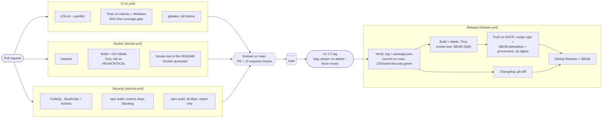

# CI/CD pipeline

[← Back to README](../README.md) · [All guides](README.md)

Every change to `main` goes through a pull request that has to pass ten checks. A `vX.Y.Z` tag then builds,
scans, signs and publishes the container image and creates a GitHub Release. Everything runs on GitHub-hosted
runners with free tooling; every action is pinned by full commit SHA, and every scanner binary by version and
SHA-256.

## Pipeline

A manual run of the Release workflow, or a pull request that changes the release pipeline, is a **dry run**: it
runs the gate, build, Trivy, smoke test, SBOM and changelog, and downloads those artifacts again with the same pinned
action the publish and release jobs use, then stops. The publish and release jobs only run for
a pushed `vX.Y.Z` tag, so a dry run never gets their write permissions.

## Why each gate exists

| Gate | Workflow | Blocks merge | Why it's there |
|---|---|---|---|
| ESLint + yamllint | CI | yes | Catches real JavaScript bugs (undefined names, unused variables) and broken workflow YAML before anything runs |
| Tests, Ubuntu + Windows, 90% line coverage | CI | yes (both OSes) | The app ships Windows start/stop scripts and runs in a Linux container, so it has to work on both. The coverage floor stops untested code piling up quietly |
| gitleaks (full history) | CI | yes | A secret committed once stays in git history even after it's deleted; scanning every commit catches that |
| hadolint | Docker | yes | Dockerfile mistakes (running as root by name, unpinned images, shell pitfalls) are easy to make and cheap to catch |
| Build + Trivy | Docker | yes | Known HIGH/CRITICAL vulnerabilities in the base image or production dependencies stop the merge. No `--ignore-unfixed`: an unfixed finding still gets a decision |
| Smoke test | Docker | yes | Runs the README's Docker quickstart and checks the API, loopback-only port, non-root user, read-only filesystem and volume ownership, so the documented setup really works and stays hardened |
| CodeQL (JavaScript, Actions) | Security | yes | Static analysis of the app, and of the workflows themselves for issues like script injection |
| npm audit, runtime deps | Security | yes | A high or critical advisory in something the app ships fails the build |
| npm audit, all deps | Security | no | Dev-tool advisories are reported in the job summary but don't block, so a lint plugin can't stop a release |
| Release gate | Release | tag only | Only a green, merged commit whose version matches the tag can be released |
| cosign + attestations | Release | tag only | Anyone can check the image was built by this repository's release workflow for that tag, without trusting the registry |

The ten required checks on `main`: `Lint (ESLint, yamllint)`, `Test (Node 22, ubuntu-latest)`,
`Test (Node 22, windows-latest)`, `Secret scan (gitleaks)`, `Lint Dockerfile (hadolint)`,
`Build and scan image (Trivy)`, `Smoke test (docker compose, README quickstart)`,
`Dependency audit (production, blocking)`, `CodeQL (javascript-typescript)` and `CodeQL (actions)`, each tied to
GitHub Actions (integration 15368). The ruleset requires a pull request, branches up to date with `main`, and has
no bypass list. Release jobs aren't required checks because they only run on tags.

## Measured run times

From real successful runs on `main` (push events), 2026-10-16 to 2026-10-19. Jobs in a workflow run in parallel,
and the three workflows run in parallel with each other.

| Workflow | Job | Runs | Min | Median | Max |
|---|---|---|---|---|---|
| CI | Lint (ESLint, yamllint) | 9 | 10 s | 12 s | 15 s |
| CI | Test (Node 22, ubuntu-latest) | 9 | 10 s | 12 s | 17 s |
| CI | Test (Node 22, windows-latest) | 9 | 27 s | 32 s | 49 s |
| CI | Secret scan (gitleaks) | 9 | 5 s | 6 s | 9 s |
| CI | **whole workflow** | 9 | 30 s | 35 s | 52 s |
| Docker | Lint Dockerfile (hadolint) | 8 | 5 s | 6 s | 8 s |
| Docker | Build and scan image (Trivy) | 8 | 20 s | 24 s | 49 s |
| Docker | Smoke test (docker compose, README quickstart) | 8 | 17 s | 22 s | 39 s |
| Docker | **whole workflow** | 8 | 25 s | 30 s | 53 s |
| Security | CodeQL (javascript-typescript) | 7 | 50 s | 59 s | 75 s |
| Security | CodeQL (actions) | 7 | 31 s | 36 s | 73 s |
| Security | Dependency audit (production, blocking) | 7 | 8 s | 10 s | 31 s |
| Security | Dependency audit (all, informational) | 7 | 8 s | 9 s | 15 s |
| Security | **whole workflow** | 7 | 54 s | 65 s | 79 s |

A pull request is ready to merge in about a minute (the Security workflow is usually the slowest).

The first release, `v0.1.0`, took **3 min 01 s** from tag push to published release: Verify release commit 5 s,
Build, scan and smoke-test image 50 s, Generate changelog 7 s, Publish to GHCR, sign and attest 105 s, Create
GitHub Release 9 s. A dry run from `main` took 61 s.

## Suppressions

| Tool | Suppression | Scope | Reason |
|---|---|---|---|
| ESLint | `no-unused-vars` with `ignoreRestSiblings: true` | `eslint.config.js`, whole project | `src/handover.js` drops a field with `({ snapshot, ...h }) => h`; the dropped name is unused on purpose. Any other unused variable still fails |

That is the only one. There are no Trivy ignores (no `.trivyignore`, no `--ignore-unfixed`), no gitleaks
allowlist, no CodeQL alert dismissals and no npm audit exceptions.

## Runner pinning

Every job runs on `ubuntu-24.04` instead of `ubuntu-latest`, because `ubuntu-latest` began moving to Ubuntu 26 on
2026-10-19 and several jobs depend on what the image ships (`ss`, `hostname -I`, `jq`, `pipx`, Docker Compose).
With a pinned image, a runner change can't break the pipeline without a code change; moving to a newer Ubuntu is a
deliberate pull request. The one exception is the Linux entry of the CI test matrix, which stays on
`ubuntu-latest`: its job name `Test (Node 22, ubuntu-latest)` is a required check, so renaming it would block every
pull request until the ruleset changed too. That job only needs Node, so it's the least exposed to an image change.

## Known gaps

- **Trivy doesn't scan the Node.js runtime.** The official `node:*-alpine` image installs Node from a tarball, not
  as an Alpine package, so Trivy sees the Alpine packages and the npm packages but not Node itself. A CVE in Node
  wouldn't fail the Trivy gate. What moves Node forward is Dependabot's weekly Docker update of the digest-pinned
  base image (major versions are ignored on purpose).
- **Pinned tool binaries are checked weekly, not updated automatically.** `scanner-versions.yml` compares every
  version- and checksum-pinned tool (gitleaks, hadolint, Trivy, Syft, cosign, git-cliff) with its latest release and
  flags a tool pinned differently in two workflows, but bumping a pin is still a manual pull request.
- **A tag can still be moved forward.** The tag ruleset blocks deleting and force-moving `v*` tags, but moving a
  tag to a newer commit is a fast-forward and isn't blocked (that would need an update restriction).
- **Images are built for `linux/amd64` only**, and the release pipeline has only been run on GitHub's x86_64
  runners.

## Verify a release

Each release's notes contain the commands below with the version and digest filled in, and the release workflow
runs them against the image before it publishes the notes. The full block is in the README's
[Verify a release](../README.md#verify-a-release) section.

1. Take `VERSION` and `DIGEST` from the release notes. Always use the digest, not a tag.
2. Check the image signature: `cosign verify` with `--certificate-identity` set to
   `https://github.com/Khaja-syed-786/soc-range/.github/workflows/release.yml@refs/tags/$VERSION` and
   `--certificate-oidc-issuer https://token.actions.githubusercontent.com`. This needs no login: the image is public
   and the signatures are in Sigstore's public transparency log.
3. Check the SBOM attestation: `cosign verify-attestation --type spdxjson` with the same identity and issuer.
4. Check the build provenance: `gh attestation verify oci://ghcr.io/khaja-syed-786/soc-range@$DIGEST --repo
   Khaja-syed-786/soc-range`.
5. Pull by digest: `docker pull ghcr.io/khaja-syed-786/soc-range@$DIGEST`.

A wrong identity or issuer makes `cosign verify` fail and print the value it actually found, which is a quick way
to see who signed an image.

## Seeing the gates fail

[`demo/break-the-pipeline.md`](../demo/break-the-pipeline.md) creates throwaway branches that each break one gate,
and records what happened when it was run.
